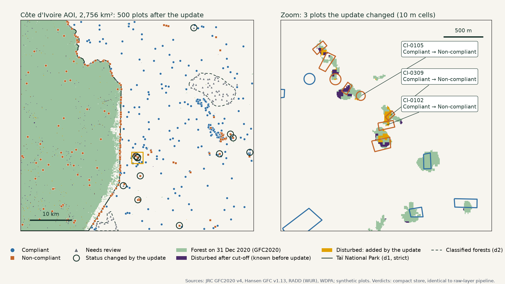

# Keep the decision, not the data

**EUDR plot verification for Ivory Coast cocoa:** a compact, query-fast store that reproduces every plot verdict. Built for the SystemEarth hackathon, October 2026.

📊 **Deck:** [Google Drive link](https://drive.google.com/) *(replace with the shared link)* · 📝 **Memo:** [docs/submission-memo.md](docs/submission-memo.md) · 📈 **Full results:** [docs/evaluation.md](docs/evaluation.md)



## Results

Measured on a 2,756 km² area on the edge of Taï National Park, with 500 test plots.

| | Result |
|---|---|
| **Storage** | 140 kB for all decision layers vs 6.05 MB of raw layers (compressed): **43× smaller**, ≈ 50 bytes/km² |
| **Query** | One plot in **32 ms** (1 tile, 0.9 kB read) vs 0.51 s on Google Earth Engine; 500 plots in 0.34 s vs 7.9 s |
| **Updates** | A new data release re-checks **39 of 500 plots** in 0.11 s, exactly the set that can change |
| **Fidelity** | **100% decision fidelity** and every output field identical to a pipeline on the raw layers; **100% pixel fidelity** on 32.4 M cells |
| **Cost** | Reanalysing 1 M plots: ≈ 11 min on one core vs ≈ 7 h on Earth Engine one request per plot (≈ 4.4 h batched); infrastructure under $1/month |

## The problem

- **EUDR** (Regulation (EU) 2023/1115) requires EU buyers to prove every plot was not deforested after **31 Dec 2020**, from 30 Dec 2026.
- **Tree-cover loss is not deforestation:** in this area 99.5% of post-2020 loss outside protected areas is on land that wasn't forest in 2020 (cocoa replanting, fallow). A loss-only check flags 22.9% of random 2 ha farms; gating by the 2020 forest map flags 0.12%.
- **Plots are checked again and again:** every data release raises "did this change any past lot?" Re-running full overlays on every release is slow and doesn't say which lots changed.

## How it works

The idea: a plot's verdict needs only two facts per 10 m cell, whether it was forest on 31 Dec 2020 and when (if ever) it was first disturbed after that. Store those, not the layers.

```
Public layers (GFC2020, Hansen, RADD, WDPA)          Plot upload (GeoJSON)
        │  once per release                                 │  once per upload
  Extract + encode                                    Index plots
        └──────────────► Compact store ◄────────────────────┘
          16-bit base raster (COG) · event file per release (Parquet)
          run-length plot index · protected-area overlaps · manifest
                              │  per check
                    DuckDB rule engine → verdicts + manifest ID
```

- **Rules first:** the decision rules are a fixed spec ([docs/decision-spec.md](docs/decision-spec.md)) implemented twice, on the raw layers (ground truth) and on the compact store, so fidelity is measurable.
- **16 bits per cell:** forest bit, 3 source bits (Hansen / RADD high / RADD low), 12-bit first-disturbance date. ZSTD-compressed Cloud-Optimised GeoTIFF; zero outside forest.
- **Event log:** each release is a small file of newly disturbed cells; joined with the plot index it names the affected plots.
- **No geometry at query time:** plots become run-length cell runs once, at upload.

Every format, threshold and dropped layer is justified in [docs/design-rationale.md](docs/design-rationale.md) and [docs/architecture.md](docs/architecture.md).

## Run it

Requires Python 3.12 and a Google Earth Engine project (a free noncommercial one works). The raw layer exports are not in the repo, so the first run exports them.

```bash
python3.12 -m venv .venv && source .venv/bin/activate
pip install -r requirements.txt
earthengine authenticate
python scripts/export_layers.py --project YOUR_PROJECT --dry-run   # checks the datasets
python scripts/export_layers.py --project YOUR_PROJECT             # starts exports to Google Drive
```

Download the four files from the Drive folder `systemearth_raw` into `data/raw/`. On macOS with the python.org installer, if authentication fails with a certificate error, run `SSL_CERT_FILE=$(python -m certifi) earthengine authenticate`.

Then:

```bash
streamlit run app/demo_console.py      # demo console: click the five steps in the sidebar
bash scripts/demo.sh                   # same flow in the terminal, one step per Enter
python -m pytest tests -q              # 53 tests, incl. compact vs raw on every field
python scripts/evaluate.py             # storage, fidelity, query, sensitivity → data/results/evaluation.json
```

Plots (`data/plots/`) and results (`data/results/`) are committed, so the docs can be read without running anything.

## Repository layout

| Path | What |
|---|---|
| `scripts/export_layers.py` | Export the raw layers from Earth Engine |
| `scripts/layers.py` | Shared readers: everything on the GFC2020 grid, plot-cell rule |
| `scripts/generate_plots.py` | 500 stratified synthetic plots in SystemEarth's GeoJSON schema |
| `scripts/baseline.py` | Raw-layer pipeline (ground truth) |
| `scripts/compact.py`, `encode_layers.py`, `index_plots.py`, `engine.py` | Compact store, encoder, plot index, DuckDB engine |
| `scripts/simulate_declarations.py`, `verify_declarations.py` | Supplier-declaration check |
| `scripts/evaluate.py`, `ee_benchmark.py`, `make_map.py` | Evaluation, Earth Engine benchmark, map |
| `app/demo_console.py` | Streamlit demo console |
| `tests/` | 53 pytest tests |
| `docs/` | Spec, architecture, design rationale, evaluation, business case, memo |

## Limitations

- Synthetic plots and one 50 km area; national figures are extrapolated per km² and per plot.
- 100% fidelity means the store loses nothing versus the raw layers, not that the satellite layers are right on the ground (GFC2020 can map shade cocoa as forest).
- The store answers today's rules; new questions need re-extraction from source.
- Not built: alert retractions, periodic fold-in, harvest-date-aware checks, automatic triggers, cloud deployment.

Details and next steps: [docs/submission-memo.md](docs/submission-memo.md).

## Data sources

- JRC Global Forest Cover 2020 (GFC2020) v4, European Commission Joint Research Centre
- Hansen, M. C. et al., Global Forest Change 2000–2025 v1.13, University of Maryland (CC BY 4.0)
- RADD forest disturbance alerts, Wageningen University & Research
- UNEP-WCMC and IUCN, Protected Planet: the World Database on Protected Areas (WDPA)

Each dataset is subject to its provider's terms of use.
